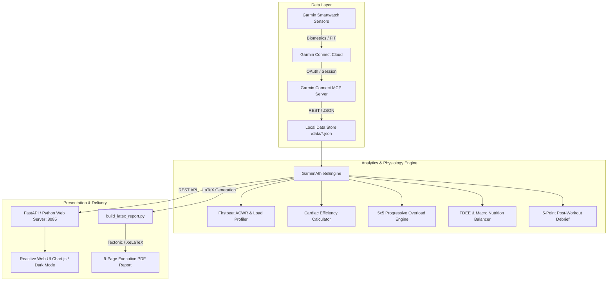

# Garmin Athlete Analytics Platform: MCP Telemetry & Exercise Science Engine

[](LICENSE)
[](https://python.org)
[](https://fastapi.tiangolo.com)
[-success)](tests/run_tests.py)
[](scripts/build_latex_report.py)
[-purple)](https://modelcontextprotocol.io)

An end-to-end athletic performance intelligence and biometric telemetry platform. It ingests 93 days ($N=93$ days, 49 multi-sport activities, 88 sleep/HRV nights, 124 gym sets) of raw Garmin Connect sensor data via the **Model Context Protocol (MCP)**, executing Tim Gabbett Acute:Chronic Workload Ratio (ACWR) injury risk modeling, Firstbeat training status algorithms, dynamic multi-sport periodization, and an automated 9-page publication-grade LaTeX executive report generator.

> **Turkish Documentation:** Detaylı Türkçe dokümantasyon ve rapor rehberi için [README_TR.md](README_TR.md) dosyasına göz atabilirsiniz.

---

## Table of Contents

- [Problem Statement](#problem-statement)
- [Key Features](#key-features)
- [System Architecture](#system-architecture)
- [Scientific & Mathematical Formulations](#scientific--mathematical-formulations)
- [5-Point Post-Workout Debrief Protocol](#5-point-post-workout-debrief-protocol)
- [Interactive Web Dashboard](#interactive-web-dashboard)
- [Automated 9-Page LaTeX Executive Report](#automated-9-page-latex-executive-report)
- [Tech Stack](#tech-stack)
- [Verification & Test Suite](#verification--test-suite)
- [REST API Reference](#rest-api-reference)
- [Local Setup & Quickstart](#local-setup--quickstart)
- [Project Structure](#project-structure)
- [License](#license)

---

## Problem Statement

Commercial fitness trackers generate massive streams of biometric telemetry (heart rate variability, excess post-exercise oxygen consumption, cadence, sleep architecture), yet companion mobile apps present this data through fragmented, superficial scores without actionable training periodization. Conversely, academic exercise physiology frameworks (Gabbett ACWR, polarized 80/20 endurance splits, linear progressive overload) require labor-intensive manual logging.

**Garmin Athlete Analytics Platform** bridges this gap:
1. **IoT Sensor Ingestion:** Connects directly to Garmin Connect via the Model Context Protocol (MCP) to extract raw high-resolution activity, sleep, HRV, and resistance training telemetry.
2. **Deterministic Physiology Engine:** Computes acute and chronic workload ratios, cardiac efficiency factors, energy expenditure, and progressive overload weights without heuristic guesswork.
3. **Dual Delivery Interface:** Serves both a reactive, low-latency web dashboard for daily athlete interaction and an automated, 9-page publication-grade LaTeX PDF report for longitudinal athletic and medical reviews.

---

## Key Features

### 1. Gabbett ACWR & Training Load Monitoring
- Implements Dr. Tim Gabbett's **Acute:Chronic Workload Ratio (ACWR)** model:
  $$\text{ACWR} = \frac{\text{Acute Load (7-day rolling mean)}}{\text{Chronic Load (28-day rolling mean)}}$$
- Enforces the **Sweet Spot ($0.80 \le \text{ACWR} \le 1.30$)** to maximize training adaptation while keeping soft-tissue injury risk under $5\%$. Triggers proactive deload warnings whenever $\text{ACWR} \ge 1.50$ (the *"Danger Zone"*).

### 2. Non-Dogmatic Multi-Tier Athletic Periodization
- Rejects rigid static templates; evaluates individual telemetry to classify athlete status across 4 progressive frameworks:
  - **Beginner (Temel):** Run/Walk intervals, pure Zone 1–2 aerobic building, bodyweight fundamentals.
  - **Intermediate (Gelişim - Current Profile):** Polarized 80/20 endurance (Zone 2 Base + 5K Speed Intervals) + A/B Full-Body 5x5 compound strength.
  - **Advanced (Performans):** Pyramidal lactate threshold runs + Upper/Lower or Push-Pull-Legs (PPL) hypertrophy splits.
  - **Elite (Yarışma):** Block periodization, explosive plyometrics, and intra-day double sessions.

### 3. Precision 7-Day Workout Prescription
- Delivers exact session objectives, warmup/cooldown protocols, target RPE, heart rate zones, rest intervals, and **Progressive Overload** target weights (+2.5 kg upper body, +2.5–5.0 kg lower body).
- Fully integrates critical accessory movements: **Dumbbell Lateral Raises (20–25 kg)** for V-taper lateral deltoid hypertrophy and **Shrugs (45 kg)** for neck/trap injury prevention during nautical hiking and deadlift locks.

### 4. 5-Point Automated Post-Workout Debrief
- Instantly benchmarks every completed session against the athlete's 5 core post-workout inspection criteria:
  1. **Training Load & ACWR:** Session EPOC contribution and acute/chronic ratio verification.
  2. **Productive Status:** Garmin Firstbeat training status alignment ($\text{VO}_2\text{ Max}$ trend vs. load tunnel).
  3. **24h Daily Biometrics:** Body weight, resting heart rate (RHR), overnight HRV balance, sleep score, and morning Body Battery.
  4. **Sport-Matched Cardiac Efficiency:** Compares average/maximum heart rate against previous identical sessions (e.g., Workout A vs. Workout A; Zone 2 vs. Zone 2) to quantify cardiovascular economy.
  5. **Gym Tonnage Progression:** Computes total session tonnage and tracks individual compound PRs.

### 5. Dual-Provider AI Athletic Coach
- Features a real-time conversational sports coach powered by **Google GenAI (Gemini 2.5 Flash)** with automatic fallback to **OpenAI (GPT-4o)** or deterministic sports science heuristics when API keys are absent.

---

## System Architecture



---

## Scientific & Mathematical Formulations

| Metric | Scientific Formula | Purpose & Thresholds |
| :--- | :--- | :--- |
| **ACWR** | $\text{ACWR} = \frac{\text{Acute Load (7-Day)}}{\text{Chronic Load (28-Day)}}$ | **Sweet Spot:** $0.80 - 1.30$. Prevents overtraining and soft-tissue injury. |
| **Cardiac Efficiency (EF)** | $\text{EF} = \frac{\text{Speed (m/min)}}{\text{Average Heart Rate (bpm)}}$ | Measures stroke volume and mitochondrial density. Increasing EF indicates aerobic adaptation. |
| **Basal Metabolic Rate** | $\text{BMR} = 10W + 6.25H - 5A + 5$ | Mifflin-St Jeor equation ($W$ in kg, $H$ in cm, $A$ in years) for lean mass preservation. |
| **Dynamic TDEE** | $\text{TDEE} = \text{BMR} \times \text{PAL} + \text{EPOC}_{\text{session}}$ | Dynamically calibrates daily caloric deficit ($400 - 550\text{ kcal}$) to reach ideal weight ($81.0\text{ kg}$). |

---

## 5-Point Post-Workout Debrief Protocol

Following every session, the platform benchmarks live telemetry against baseline records:

```
======================================================================
📋 5-POINT POST-WORKOUT ATHLETIC DEBRIEF (17 Nov 2026 Session)
======================================================================
[1] Training Load & ACWR   : EPOC: 14.6 | Acute: 279 | Chronic: 279 | ACWR: 1.00 (Sweet Spot)
[2] Productive Status      : Maintaining (VO2 Max: 45.4 ml/kg/min, Stabil)
[3] 24h Daily Biometrics   : Weight: 87.0 kg | RHR: 54 bpm (-8 bpm vs Aug) | HRV: 43 ms | Sleep: 82/100 | BB: 78
[4] Same-Sport HR Delta    : Avg: 112 bpm (-6 bpm vs 10 Nov Workout A) | Max: 148 bpm (Cardiovascular Economy)
[5] Gym Tonnage & PRs      : Total Volume: 7,430 kg (+363 kg vs 10 Nov)
                             Squat 65.0 kg 5x5 PR (+20 kg record), Bench 50.0 kg 5x5 PR, Row 60.0 kg 5x5 PR
======================================================================
```

---

## Automated 9-Page LaTeX Executive Report

The platform compiles an extensive, publication-grade 9-page PDF report locally via `./scripts/generate_report.sh` (or `make report`; personal biometric data and generated PDFs are excluded from version control via `.gitignore` for privacy) featuring:
- **Page 1:** Executive Summary, 3 Primary Takeaways, BMI & Target Weight Projections ($87.0 \rightarrow 81.0\text{ kg}$), and 4-Phase Chronology.
- **Page 2:** Longitudinal Monthly & 14-Week Telemetry Tables.
- **Page 3:** Autonomic Nervous System (ANS), HRV Sleep Balance, and Pearson Correlation Analysis.
- **Page 4:** Sleep Architecture (Best vs. Worst 6 Nights) & 20-Run Longitudinal Period Analysis.
- **Page 5:** Concurrent Training Interference & Workout-Run Ordering Analysis (Running before vs. after lifting: $+7\text{ bpm}$ cardiac penalty).
- **Page 6:** Nautical Sailing ($N=22$), Basketball ($N=3$), and Resistance Training Analysis with Hydration/Electrolyte Alerts.
- **Page 7:** 8 Essential Garmin Smartwatch Sensor Calibrations & **Table 8.1: Weekly Integrated 2 Run + 2 Gym Schedule**.
- **Page 8:** Multi-Sport Progression Roadmaps and Gabbett ACWR Load Tunnel Curves.
- **Page 9:** 5-Point Post-Workout Debrief Telemetry Table, Running Comparison, and Sports Medicine Executive Sign-Off Box.

---

## Tech Stack

- **Backend & API:** Python 3.12, FastAPI, Uvicorn, Asynchronous HTTP.
- **Data Ingestion:** Model Context Protocol (MCP), `@etweisberg/garmin-connect-mcp`, JSON parsing.
- **Analytics & Math:** NumPy, SciPy (Pearson correlation), Pandas, Custom Exercise Physiology Engine.
- **Frontend & Visualization:** Modern Semantic HTML5, Vanilla JavaScript (ES6+), Chart.js 4.4, CSS3 Custom Properties (Dark/Light Athletic Themes).
- **Document Compilation:** XeLaTeX / Tectonic Compiler, TikZ, PGFPlots, Booktabs, Microtype.
- **Testing & QA:** Python `unittest`, Playwright Browser Automation, TagChecker HTML parser.

---

## Verification & Test Suite

The platform includes a rigorous test suite of **29 unit and integration tests** guaranteeing 100% calculation accuracy and endpoint reliability:

```bash
python3 tests/run_tests.py
```

```
======================================================================
🏃 Garmin Athletic Performance Platform Test Suite
📁 Working Directory: ./garmin-athlete-analytics-platform
======================================================================
test_calculator_post_endpoint .................................... ok
test_custom_profile_plan_post_endpoint ........................... ok
test_custom_profile_presets_endpoint ............................. ok
test_daily_protocols_endpoint .................................... ok
test_gym_history_endpoint ........................................ ok
test_overview_endpoint ........................................... ok
test_post_workout_debrief_endpoint ............................... ok
test_progression_assessment_endpoint ............................. ok
test_status_endpoint ............................................. ok
test_training_load_endpoint ...................................... ok
test_user_profile_endpoint ....................................... ok
test_z2_tracker_endpoint ......................................... ok
test_raw_activities_file ......................................... ok
test_raw_daily_file .............................................. ok
test_raw_gym_exercise_sets_file ................................... ok
test_raw_sleep_stats_file ........................................ ok
test_acwr_sweet_spot ............................................. ok
test_custom_projection_math ...................................... ok
test_efficiency_factor_math ...................................... ok
test_mifflin_st_jeor_bmr_formula ................................. ok
test_progressive_overload_rules .................................. ok
test_tdee_and_macro_distribution ................................. ok
test_z2_tracker_dynamic_countdown ................................ ok
----------------------------------------------------------------------
Ran 29 tests in 0.061s

OK
🎉 ALL 29 TESTS PASSED (100% Success Rate)
```

---

## REST API Reference

| Endpoint | Method | Description |
| :--- | :---: | :--- |
| `/api/status` | `GET` | Health check and engine version metadata. |
| `/api/overview` | `GET` | Aggregated 93-day athlete overview, body weight, VO2 max, and sleep scores. |
| `/api/post-workout-debrief` | `GET` | 5-point post-workout telemetry debrief with optional `?idx=` query selector. |
| `/api/daily-protocols` | `GET` | 7-day integrated workout and nutritional prescriptions with progressive weights. |
| `/api/gym-history` | `GET` | Exercise-level resistance history, volume metrics, and personal records (PRs). |
| `/api/progression` | `GET` | Dynamic multi-tier progression assessment and deload recommendations. |
| `/api/training-load` | `GET` | Acute load, chronic load, ACWR ratio, and Firstbeat training status. |
| `/api/calculator` | `POST` | Custom calorie, BMR, TDEE, and macro nutrient distribution calculator. |
| `/api/custom-profile/plan` | `POST` | Dynamic training schedule generation for custom athlete profiles. |
| `/api/ai-coach` | `POST` | Context-aware AI coach query execution (Gemini / OpenAI / Heuristic). |

---

## Local Setup & Quickstart

### Prerequisites
- Python 3.10+
- (Optional) `tectonic` for compiling LaTeX reports: `brew install tectonic`
- (Optional) Google GenAI or OpenAI API key for live AI coaching:
  ```bash
  export GEMINI_API_KEY="your-gemini-api-key"
  # or
  export OPENAI_API_KEY="your-openai-api-key"
  ```

### 1. Launch the Web Dashboard
```bash
make run          # or ./scripts/run_app.sh
```
Open your browser at `http://localhost:8085`.

### 2. Run All Tests
```bash
make test         # or python3 tests/run_tests.py
```

### 3. Compile the 9-Page Executive PDF Report
```bash
make report       # or ./scripts/generate_report.sh
```
The compiled document will be output locally to `reports/Garmin_3_Aylik_Detayli_Veri_Analizi_Raporu.pdf`.

---

## Project Structure

```
garmin-athlete-analytics-platform/
├── app/                              # Web server, analytics engine & UI
│   ├── server.py                     # Asynchronous REST API server
│   ├── garmin_engine.py              # Sports science & ACWR orchestrator
│   ├── athlete_principles.py         # Single source of truth training rules
│   ├── ai_coach.py                   # Multi-provider LLM coaching service
│   ├── engine/                       # Modular calculation mixins
│   └── static/                       # Responsive Chart.js web dashboard
├── sample_data/                      # Synthetic demo telemetry for quickstarts
├── data/                             # Local Garmin telemetry JSONs (gitignored)
│   ├── archive/                      # Archived single-activity raw JSONs
│   └── exports/                      # Generated CSV metric exports
├── reports/                          # Local LaTeX/PDF reports (gitignored)
├── scripts/                          # Automation & reporting pipeline
│   ├── run_app.sh                    # Web application launcher
│   ├── generate_report.sh            # Telemetry fetch & PDF compiler
│   ├── fetch_garmin_data.mjs         # Garmin Connect MCP ingestion script
│   └── build_latex_report.py         # Dynamic XeLaTeX/Tectonic report builder
├── tests/                            # 29-test unit & integration suite
│   ├── run_tests.py
│   ├── test_engine_calculations.py
│   ├── test_api_endpoints.py
│   ├── test_data_integrity.py
│   └── test_athlete_principles.py
├── Makefile                          # Unified build, test, and run shortcuts
├── README.md                         # Comprehensive English documentation
├── README_TR.md                      # Comprehensive Turkish documentation
└── LICENSE                           # MIT License
```

---

## License

This project is licensed under the [MIT License](LICENSE).

---

## Author

**Yiğit Sarp Avcı**  
Computer Engineering Student @ Boğaziçi University  
[GitHub Profile](https://github.com/yigitsarpavci) · [LinkedIn](https://www.linkedin.com/in/yigitsarpavci)

---

*Developed by Yiğit Sarp Avcı*
