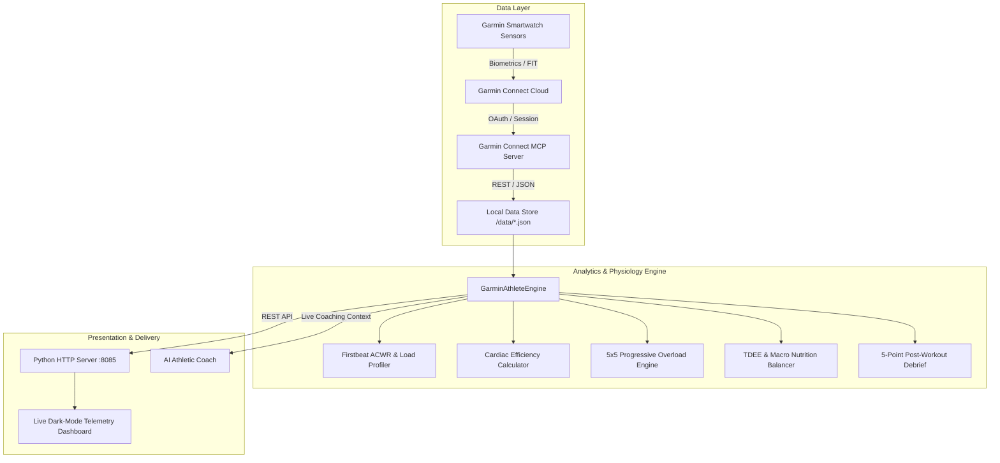

# Garmin Athlete Analytics Platform: MCP Telemetry & Exercise Science Engine

[](https://github.com/yigitsarpavci/garmin-athlete-analytics-platform/security)
[](LICENSE)
[](https://python.org)
[](https://github.com/yigitsarpavci/garmin-athlete-analytics-platform/actions/workflows/tests.yml)
[-purple)](https://modelcontextprotocol.io)

An end-to-end athletic performance intelligence and biometric telemetry platform. It ingests 93 days ($N=93$ days, 49+ multi-sport activities, 88+ sleep/HRV nights, and resistance sets) of raw Garmin Connect sensor data via the **Model Context Protocol (MCP)**, executing Tim Gabbett Acute:Chronic Workload Ratio (ACWR) injury risk modeling, Firstbeat training status algorithms, dynamic multi-sport weekly quota adaptation, and live dark-mode physiological analytics.

> **Turkish Documentation:** Detaylı Türkçe dokümantasyon için [README_TR.md](README_TR.md) dosyasına göz atabilirsiniz.

---

## Table of Contents

- [Problem Statement](#problem-statement)
- [Key Features](#key-features)
- [System Architecture](#system-architecture)
- [Scientific & Mathematical Formulations](#scientific--mathematical-formulations)
- [5-Point Post-Workout Debrief Protocol](#5-point-post-workout-debrief-protocol)
- [Tech Stack](#tech-stack)
- [Athlete Profile](#athlete-profile-nothing-personal-lives-in-the-code)
- [Security & Privacy](#security--privacy)
- [Language & Conventions](#language--conventions)
- [Verification & Test Suite](#verification--test-suite)
- [REST API Reference](#rest-api-reference)
- [Local Setup & Quickstart](#local-setup--quickstart)
- [Project Structure](#project-structure)
- [License](#license)

---

## Problem Statement

Commercial fitness trackers generate massive streams of biometric telemetry (heart rate variability, excess post-exercise oxygen consumption, cadence, sleep architecture), yet companion mobile apps present this data through fragmented, superficial scores without actionable training periodization. Conversely, academic exercise physiology frameworks (Gabbett ACWR, Firstbeat training status, linear progressive overload) require labor-intensive manual logging.

**Garmin Athlete Analytics Platform** bridges this gap:
1. **IoT Sensor Ingestion & High-Res FIT Parsing:** Connects directly to Garmin Connect via the Model Context Protocol (MCP) to extract raw 93-day activity, sleep, 5-minute overnight HRV (RMSSD), Running Dynamics (`GCT`, vertical oscillation/ratio, power), body weight, and `1 Hz` binary `.fit` streams (`app/engine/fit_stream_parser.py`).
2. **Deterministic Physiology & Flexible Quota Engine:** Computes acute and chronic workload ratios, cardiac efficiency factors, energy expenditure, dynamic morphology projections, progressive overload weights, and Monday-reset flexible weekly quotas without heuristic guesswork.
3. **Single-Screen Forest-Dark Telemetry Workspace:** Serves a zero-scroll (`100vh`) deep-forest dark-mode web dashboard backed by modular Python analytics engines, incremental Garmin sync every 15 min with quick retries when Garmin data is incomplete (`GARMIN_SYNC_INTERVAL_SEC`), automatic reload when data files change on disk, and a cross-process fetch lock, 4-minute adaptive SSO keep-alive (`GET /api/session/keepalive`), and an offline synthetic demo mode (`GARMIN_DEMO_MODE=1` / `--demo`).

---

## Key Features

### 1. Gabbett ACWR & Training Load Monitoring
- Implements Dr. Tim Gabbett's **Acute:Chronic Workload Ratio (ACWR)** model:
  $$\text{ACWR} = \frac{\text{Acute Load (7-day rolling mean)}}{\text{Chronic Load (28-day rolling mean)}}$$
- Enforces the **Sweet Spot ($0.80 \le \text{ACWR} \le 1.30$)** to maximize training adaptation while keeping soft-tissue injury risk under $5\%$. Triggers proactive deload warnings whenever $\text{ACWR} \ge 1.50$ (the *"Danger Zone"*).

### 2. Rule-Based Weekly Periodization
- **Strength:** always 2 sessions per week, alternating full-body **Workout A / Workout B** (5x5 compound lifts), with progressive-overload targets derived from the athlete's own Garmin set history.
- **Running:** a base of 2-3 runs per week. The weekly target may intentionally drop to 0-1 when all Firstbeat load bars are already full (overload guard).
- **Deload instead of extra volume:** when every bar is full and will not decay by Sunday, the platform recommends a deload until the end of the week and never adds an extra gym session.
- **Run vocabulary:** run advice uses Garmin Quick Workout names (**Interval**, **Tempo**, **Zone 2**) and heart-rate bands derived as percentages of the athlete's own max HR.

### 3. Precision 7-Day Workout Prescription
- Delivers session objectives, warmup/cooldown protocols, target RPE, heart-rate zones, rest intervals, and **Progressive Overload** target weights computed from the athlete's own set history.

### 4. 5-Point Automated Post-Workout Debrief
- Instantly benchmarks every completed session against the athlete's 5 core post-workout inspection criteria:
  1. **Training Load & ACWR:** Session EPOC contribution and acute/chronic ratio verification.
  2. **Productive Status:** Garmin Firstbeat training status alignment ($\text{VO}_2\text{ Max}$ trend vs. load tunnel).
  3. **24h Daily Biometrics:** Body weight, resting heart rate (RHR), overnight HRV balance, sleep score, and morning Body Battery.
  4. **Sport-Matched Cardiac Efficiency:** Compares average/maximum heart rate against previous identical sessions (e.g., Workout A vs. Workout A; Zone 2 vs. Zone 2) to quantify cardiovascular economy.
  5. **Gym Tonnage Progression:** Computes total session tonnage and tracks individual compound PRs.

### 5. Dual-Provider AI Athletic Coach
- Features a real-time conversational sports coach powered by **Google GenAI (Gemini 2.5 Flash)** with automatic fallback to **OpenAI (GPT-4o-mini)** or deterministic sports science heuristics when API keys are absent.

### 6. High-Res Binary FIT Streams, Session Keep-Alive & Demo Mode
- **Binary `.fit` Decoder (`app/engine/fit_stream_parser.py`):** Decodes native Garmin FIT binary frames (`1 Hz` heart rate, cadence, stride length, ground contact time, and vertical oscillation) plus 5-minute overnight HRV and respiration series exposed via `GET /api/garmin-expansion`.
- **Adaptive Session Continuity:** Runs a background 4-minute keep-alive loop (`GET /api/session/keepalive`) and rolling session lease fallback so `/api/sync` stays responsive and refreshes local telemetry cleanly without interrupting dashboard sessions.
- **Portable Demo Mode:** Launch with `GARMIN_DEMO_MODE=1` or `--demo` to run seamlessly against synthetic telemetry in `sample_data/`.

---

## System Architecture



---

## Scientific & Mathematical Formulations

| Metric | Scientific Formula | Purpose & Thresholds |
| :--- | :--- | :--- |
| **ACWR** | $\text{ACWR} = \frac{\text{Acute Load (7-Day)}}{\text{Chronic Load (28-Day)}}$ | **Sweet Spot:** $0.80 - 1.30$. Prevents overtraining and soft-tissue injury. |
| **Cardiac Efficiency (EF)** | $\text{EF} = \frac{\text{Speed (m/min)}}{\text{Average Heart Rate (bpm)}}$ | Measures stroke volume and mitochondrial density. Increasing EF indicates aerobic adaptation. |
| **Basal Metabolic Rate** | $\text{BMR} = 10W + 6.25H - 5A + 5$ | Mifflin-St Jeor equation ($W$ in kg, $H$ in cm, $A$ in years) for lean mass preservation. |
| **Dynamic TDEE** | $\text{TDEE} = \text{BMR} \times \text{PAL} + \text{EPOC}_{\text{session}}$ | Dynamically calibrates daily caloric deficit ($400 - 550\text{ kcal}$) toward the `target_weight_kg` set in the athlete profile. |

---

## 5-Point Post-Workout Debrief Protocol

Following every session, the platform benchmarks live telemetry against baseline records:

```
======================================================================
📋 5-POINT POST-WORKOUT ATHLETIC DEBRIEF (synthetic demo data)
======================================================================
[1] Training Load & ACWR   : EPOC: 14.6 | Acute: 279 | Chronic: 279 | ACWR: 1.00 (Sweet Spot)
[2] Productive Status      : Maintaining (VO2 Max: 48.0 ml/kg/min, Stabil)
[3] 24h Daily Biometrics   : Weight: 78.0 kg | RHR: 55 bpm (-5 bpm vs 4w ago) | HRV: 48 ms | Sleep: 80/100 | BB: 74
[4] Same-Sport HR Delta    : Avg: 112 bpm (-6 bpm vs last Workout A) | Max: 148 bpm (Cardiovascular Economy)
[5] Gym Tonnage & PRs      : Total Volume: 7,430 kg (+300 kg vs last Workout A)
                             Squat 70.0 kg 5x5 PR, Bench 50.0 kg 5x5 PR, Row 55.0 kg 5x5 PR
======================================================================
```

---

## Tech Stack

- **Backend & API:** Python 3.10+, Modular Telemetry & Quota Engine, multi-threaded Standard Library HTTP Server (`ThreadingHTTPServer`).
- **Data Ingestion:** Model Context Protocol (MCP), `@etweisberg/garmin-connect-mcp`, live weight & exercise sets ingestion.
- **Analytics & Math:** NumPy, Pandas, Gabbett ACWR, Dynamic Morphology & Exercise Physiology Engine.
- **Frontend & Visualization:** Semantic HTML5, Vanilla ES6+ Modules, Tailwind (precompiled), Dark-Mode Telemetry Design System.
- **Testing & QA:** Python `unittest`, Playwright Browser Automation.

---

## Verification & Test Suite

The platform includes a comprehensive test suite of **99 unit, integration, security and UI-contract tests** guaranteeing calculation accuracy, FIT/high-res stream parsing, flexible weekly quota transitions, sample-data parity, and endpoint reliability:

```bash
python3 tests/run_tests.py
```

```
======================================================================
🏃 Garmin Sporcu Platformu Test Süiti Başlatılıyor
======================================================================
test_garmin_expansion_high_res_endpoint ........................ ok
test_sample_data_mock_engine_parity ............................ ok
test_monday_reset_with_last_week_deficit_adaptation ............ ok
test_off_plan_tempo_run_not_counted_as_interval_and_replans_week ok
test_unknown_sport_dynamic_weight_and_anaerobic_focus .......... ok
test_weekly_quota_summary_states ............................... ok
test_weekly_schedule_respects_completed_quota .................. ok
... (+30 API, data-integrity, and sports-science tests) ......... ok
----------------------------------------------------------------------
Ran 99 tests

OK
🎉 TÜM TESTLER BAŞARIYLA TAMAMLANDI! (%100 Geçti)
```

---

## REST API Reference

| Endpoint | Method | Description |
| :--- | :---: | :--- |
| `/api/status` | `GET` | Health check, demo/live flag, and rolling session JWT/lease metadata. |
| `/api/session/keepalive` | `GET` / `POST` | Adaptive Garmin session keep-alive heartbeat and lease renewal. |
| `/api/overview` | `GET` | Aggregated 93-day athlete overview, flexible weekly quota, weight, VO2 max, and sleep scores. |
| `/api/post-workout-debrief` | `GET` | 5-point post-workout telemetry debrief with optional `?idx=` query selector. |
| `/api/daily-protocols` | `GET` | 7-day integrated workout and nutritional prescriptions with progressive weights. |
| `/api/gym-history` | `GET` | Exercise-level resistance history, volume metrics, and personal records (PRs). |
| `/api/activities` | `GET` | All recorded Garmin activities (sport filter supported). |
| `/api/correlations` | `GET` | Pearson correlation matrix with p-values. |
| `/api/progression` | `GET` | Dynamic multi-tier progression assessment and deload recommendations. |
| `/api/sync` | `POST` | Trigger Garmin Connect sync with rolling lease reload fallback. |
| `/api/chat` | `POST` | Context-aware AI coach query execution (Gemini / OpenAI / Heuristic). |

---

## Local Setup & Quickstart

### Prerequisites
- Python 3.10+ and `pip install -r requirements.txt` (pandas, numpy)
- (Optional) Node.js 18+ for live Garmin Connect telemetry sync (`make fetch`)
- (Optional) Google GenAI or OpenAI API key for live AI coaching:
  ```bash
  export GEMINI_API_KEY="your-gemini-api-key"
  # or
  export OPENAI_API_KEY="your-openai-api-key"
  ```

### 1. Launch as macOS Desktop App (Recommended on macOS) or Web Dashboard

- **macOS Native App (`WKWebView`, macOS 13+ only):**
  ```bash
  bash macos/build_app.sh
  ```
  Installs the native macOS desktop app (`Garmin 2.0.app`) to `~/Desktop` and `~/Applications`. Clicking the app starts the local server automatically, keeps data synced while open, and terminates the background server cleanly when closed.
- **Web Dashboard (macOS / Linux / Windows):**
  ```bash
  make run                       # Live telemetry (or ./scripts/run_app.sh)
  python3 app/server.py --demo   # Offline synthetic demo mode (or GARMIN_DEMO_MODE=1)
  ```
  Open your browser at `http://localhost:8085`.

### 2. Run All Tests
```bash
make test         # or python3 tests/run_tests.py
```

### 3. Sync Fresh Telemetry from Garmin Connect
```bash
make fetch        # or node ./scripts/fetch_garmin_data.mjs
```

---

## Athlete Profile (nothing personal lives in the code)

Age, height, gender and goals are **never hard-coded**. They are read at runtime, in this order:

1. `data/athlete_profile.json` – optional overrides you write yourself (git-ignored). Copy [`athlete_profile.example.json`](athlete_profile.example.json) and edit it.
2. `data/raw_profile.json` – downloaded from Garmin Connect by `make fetch` (birth date → age, height, gender, lactate-threshold HR).
3. Neutral defaults. `/api/overview` then reports `athlete.profile_missing`, so the UI/CLI can tell the user which fields to fill in.

Everything else is derived from the athlete's **own Garmin data**: weight history, max/resting HR, Zone 2 and interval heart-rate bands (percentages of max HR), Zone 2 pace (efficiency factor at Z2 heart rate), interval pace (90 % of the current 5K pace), HR/power zones, lift starting loads (from body weight) and progression (from Garmin set data). Optional profile keys: `target_weight_kg`, `max_hr`, `lactate_threshold_hr`, `goal_5k_time` (e.g. `"24:30"`), `z2_goal_pace` (`"5:00"`), `z2_goal_date` (`"2027-04-15"`). Macro periods, the activity window, the Zone 2 goal timeline and guest-plan heart-rate bands are all derived from your own date range, Garmin data or profile; there are no hard-coded dates.

## Security & Privacy

The dashboard serves personal health data, so the server is locked down to the local machine:

- Binds to `127.0.0.1` only. Requests whose `Host` header is not `localhost` / `127.0.0.1` / `::1` are rejected (DNS-rebinding defence).
- **No CORS.** The UI is same-origin; requests carrying a foreign `Origin`, or `Sec-Fetch-Site: cross-site`, get `403`. A random website open in your browser cannot read your data or trigger `/api/sync`.
- `GET` endpoints have no side effects (only `POST /api/sync` and `POST /api/session/keepalive` contact Garmin). POST bodies are capped at 1 MB.
- Strict `Content-Security-Policy` (`script-src 'self'`, no inline scripts or inline event handlers: the UI uses `data-calls` attributes and one delegated listener), `X-Frame-Options: DENY`, `nosniff`.
- The UI is fully **offline-capable**: Lucide and the fonts are vendored with pinned versions and SHA-256 hashes in [`app/static/vendor/VENDOR.md`](app/static/vendor/VENDOR.md). No CDN is contacted at runtime.
- Personal telemetry lives in `data/` (git-ignored). Demo mode (`GARMIN_DEMO_MODE=1`) never touches your Garmin account or `data/`.

## Language & Conventions

- **Code identifiers, API keys and file names are English.** Product copy that the athlete reads (UI text, coaching messages, docstrings and comments in the engine) is **Turkish** by design: the app is a personal coaching tool for a Turkish-speaking athlete. The English README exists for developers; [README_TR.md](README_TR.md) mirrors it.
- Engine modules are mixins composed by `GarminAthleteEngine`; computation stays in the backend and the UI only renders.
- Any change must keep `python -B tests/run_tests.py` green. CI (`.github/workflows/tests.yml`) runs the suite on Python 3.10 and 3.12 against synthetic `sample_data/`.
- Install dependencies with `pip install -r requirements.txt`.

### 4. Developer tooling
```bash
make css      # rebuild app/static/css/tailwind.css (Tailwind 3.4.17 CLI via npx; no runtime compiler in the browser)
make lint     # ruff (pyflakes rules) over app/, tests/, scripts/
make test     # 99 tests
```
CI also fails when `css/tailwind.css` is stale. The Garmin sync is **incremental** (finalised days are cached; `node scripts/fetch_garmin_data.mjs --full` forces a complete refresh).

## Project Structure

```
garmin-athlete-analytics-platform/
├── app/                              # Web server, analytics engine & UI
│   ├── server.py                     # REST API and static asset server
│   ├── garmin_engine.py              # Sports science & ACWR orchestrator
│   ├── ai_coach.py                   # Multi-provider LLM coaching service
│   ├── engine/                       # Modular telemetry, quota & morphology mixins
│   └── static/                       # Dark-mode modular web dashboard (vendor/: pinned offline libs & fonts)
├── sample_data/                      # Synthetic demo telemetry for quickstarts
├── data/                             # Local Garmin telemetry JSONs (gitignored)
│   └── archive/                      # Archived single-activity raw JSONs
├── scripts/                          # Live sync & launch scripts
│   ├── run_app.sh                    # Web application launcher
│   └── fetch_garmin_data.mjs         # Garmin Connect MCP ingestion script
├── tests/                            # Automated unit & API test suite
│   ├── run_tests.py
│   ├── test_engine_calculations.py
│   ├── test_api_endpoints.py
│   ├── test_data_integrity.py
├── .github/workflows/tests.yml       # CI: tests (Python 3.10 / 3.12) + JS syntax check
├── requirements.txt                  # pandas, numpy (+ optional AI / FIT extras)
├── Makefile                          # Unified run, test, and fetch shortcuts
├── README.md                         # English documentation
├── README_TR.md                      # Turkish documentation
└── LICENSE                           # MIT License
```

---

## License

This project is licensed under the [MIT License](LICENSE).

---

## Author

**Yiğit Sarp Avcı**  
Computer Engineering Student @ Boğaziçi University  
[GitHub Profile](https://github.com/yigitsarpavci) · [LinkedIn](https://www.linkedin.com/in/yigitsarpavci)

---

*Developed by Yiğit Sarp Avcı*
