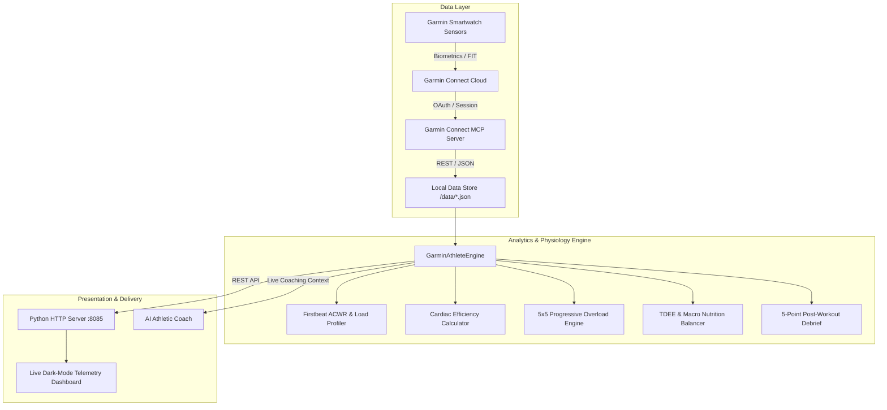

# Garmin Athlete Analytics Platform: MCP Telemetry & Exercise Science Engine

[](LICENSE)
[](https://python.org)
[](https://fastapi.tiangolo.com)
[-success)](tests/run_tests.py)
[-purple)](https://modelcontextprotocol.io)

An end-to-end athletic performance intelligence and biometric telemetry platform. It ingests 93 days ($N=93$ days, 49+ multi-sport activities, 88+ sleep/HRV nights, and resistance sets) of raw Garmin Connect sensor data via the **Model Context Protocol (MCP)**, executing Tim Gabbett Acute:Chronic Workload Ratio (ACWR) injury risk modeling, Firstbeat training status algorithms, dynamic multi-sport weekly quota adaptation, and live dark-mode physiological analytics.

> **Turkish Documentation:** Detaylı Türkçe dokümantasyon için [README_TR.md](README_TR.md) dosyasına göz atabilirsiniz.

---

## Table of Contents

- [Problem Statement](#problem-statement)
- [Key Features](#key-features)
- [System Architecture](#system-architecture)
- [Scientific & Mathematical Formulations](#scientific--mathematical-formulations)
- [5-Point Post-Workout Debrief Protocol](#5-point-post-workout-debrief-protocol)
- [Tech Stack](#tech-stack)
- [Verification & Test Suite](#verification--test-suite)
- [REST API Reference](#rest-api-reference)
- [Local Setup & Quickstart](#local-setup--quickstart)
- [Project Structure](#project-structure)
- [License](#license)

---

## Problem Statement

Commercial fitness trackers generate massive streams of biometric telemetry (heart rate variability, excess post-exercise oxygen consumption, cadence, sleep architecture), yet companion mobile apps present this data through fragmented, superficial scores without actionable training periodization. Conversely, academic exercise physiology frameworks (Gabbett ACWR, polarized 80/20 endurance splits, linear progressive overload) require labor-intensive manual logging.

**Garmin Athlete Analytics Platform** bridges this gap:
1. **IoT Sensor Ingestion & High-Res FIT Parsing:** Connects directly to Garmin Connect via the Model Context Protocol (MCP) to extract raw 93-day activity, sleep, 5-minute overnight HRV (RMSSD), Running Dynamics (`GCT`, vertical oscillation/ratio, power), body weight, and `1 Hz` binary `.fit` streams (`app/engine/fit_stream_parser.py`).
2. **Deterministic Physiology & Flexible Quota Engine:** Computes acute and chronic workload ratios, cardiac efficiency factors, energy expenditure, dynamic morphology projections, progressive overload weights, and Monday-reset flexible weekly quotas without heuristic guesswork.
3. **Single-Screen Forest-Dark Telemetry Workspace:** Serves a zero-scroll (`100vh`) deep-forest dark-mode web dashboard backed by modular Python analytics engines, 15-minute live Garmin sync, 4-minute adaptive SSO keep-alive (`GET /api/session/keepalive`), and an offline synthetic demo mode (`GARMIN_DEMO_MODE=1` / `--demo`).

---

## Key Features

### 1. Gabbett ACWR & Training Load Monitoring
- Implements Dr. Tim Gabbett's **Acute:Chronic Workload Ratio (ACWR)** model:
  $$\text{ACWR} = \frac{\text{Acute Load (7-day rolling mean)}}{\text{Chronic Load (28-day rolling mean)}}$$
- Enforces the **Sweet Spot ($0.80 \le \text{ACWR} \le 1.30$)** to maximize training adaptation while keeping soft-tissue injury risk under $5\%$. Triggers proactive deload warnings whenever $\text{ACWR} \ge 1.50$ (the *"Danger Zone"*).

### 2. Non-Dogmatic Multi-Tier Athletic Periodization
- Rejects rigid static templates; evaluates individual telemetry to classify athlete status across 4 progressive frameworks:
  - **Beginner (Temel):** Run/Walk intervals, pure Zone 1–2 aerobic building, bodyweight fundamentals.
  - **Intermediate (Gelişim - Current Profile):** Polarized 80/20 endurance (Zone 2 Base + 5K Speed Intervals) + A/B Full-Body 5x5 compound strength.
  - **Advanced (Performans):** Pyramidal lactate threshold runs + Upper/Lower or Push-Pull-Legs (PPL) hypertrophy splits.
  - **Elite (Yarışma):** Block periodization, explosive plyometrics, and intra-day double sessions.

### 3. Precision 7-Day Workout Prescription
- Delivers exact session objectives, warmup/cooldown protocols, target RPE, heart rate zones, rest intervals, and **Progressive Overload** target weights (+2.5 kg upper body, +2.5–5.0 kg lower body).
- Fully integrates critical accessory movements: **Dumbbell Lateral Raises (20–25 kg)** for V-taper lateral deltoid hypertrophy and **Shrugs (45 kg)** for neck/trap injury prevention during nautical hiking and deadlift locks.

### 4. 5-Point Automated Post-Workout Debrief
- Instantly benchmarks every completed session against the athlete's 5 core post-workout inspection criteria:
  1. **Training Load & ACWR:** Session EPOC contribution and acute/chronic ratio verification.
  2. **Productive Status:** Garmin Firstbeat training status alignment ($\text{VO}_2\text{ Max}$ trend vs. load tunnel).
  3. **24h Daily Biometrics:** Body weight, resting heart rate (RHR), overnight HRV balance, sleep score, and morning Body Battery.
  4. **Sport-Matched Cardiac Efficiency:** Compares average/maximum heart rate against previous identical sessions (e.g., Workout A vs. Workout A; Zone 2 vs. Zone 2) to quantify cardiovascular economy.
  5. **Gym Tonnage Progression:** Computes total session tonnage and tracks individual compound PRs.

### 5. Dual-Provider AI Athletic Coach
- Features a real-time conversational sports coach powered by **Google GenAI (Gemini 2.5 Flash)** with automatic fallback to **OpenAI (GPT-4o)** or deterministic sports science heuristics when API keys are absent.

### 6. High-Res Binary FIT Streams, Session Keep-Alive & Demo Mode
- **Binary `.fit` Decoder (`app/engine/fit_stream_parser.py`):** Decodes native Garmin FIT binary frames (`1 Hz` heart rate, cadence, stride length, ground contact time, and vertical oscillation) plus 5-minute overnight HRV and respiration series exposed via `GET /api/garmin-expansion`.
- **Adaptive Session Continuity:** Runs a background 4-minute keep-alive loop (`GET /api/session/keepalive`) and rolling session lease fallback so `/api/sync` stays responsive and refreshes local telemetry cleanly without interrupting dashboard sessions.
- **Portable Demo Mode:** Launch with `GARMIN_DEMO_MODE=1` or `--demo` to run seamlessly against synthetic telemetry in `sample_data/`.

---

## System Architecture



---

## Scientific & Mathematical Formulations

| Metric | Scientific Formula | Purpose & Thresholds |
| :--- | :--- | :--- |
| **ACWR** | $\text{ACWR} = \frac{\text{Acute Load (7-Day)}}{\text{Chronic Load (28-Day)}}$ | **Sweet Spot:** $0.80 - 1.30$. Prevents overtraining and soft-tissue injury. |
| **Cardiac Efficiency (EF)** | $\text{EF} = \frac{\text{Speed (m/min)}}{\text{Average Heart Rate (bpm)}}$ | Measures stroke volume and mitochondrial density. Increasing EF indicates aerobic adaptation. |
| **Basal Metabolic Rate** | $\text{BMR} = 10W + 6.25H - 5A + 5$ | Mifflin-St Jeor equation ($W$ in kg, $H$ in cm, $A$ in years) for lean mass preservation. |
| **Dynamic TDEE** | $\text{TDEE} = \text{BMR} \times \text{PAL} + \text{EPOC}_{\text{session}}$ | Dynamically calibrates daily caloric deficit ($400 - 550\text{ kcal}$) to reach ideal weight ($81.0\text{ kg}$). |

---

## 5-Point Post-Workout Debrief Protocol

Following every session, the platform benchmarks live telemetry against baseline records:

```
======================================================================
📋 5-POINT POST-WORKOUT ATHLETIC DEBRIEF (17 Nov 2026 Session)
======================================================================
[1] Training Load & ACWR   : EPOC: 14.6 | Acute: 279 | Chronic: 279 | ACWR: 1.00 (Sweet Spot)
[2] Productive Status      : Maintaining (VO2 Max: 45.4 ml/kg/min, Stabil)
[3] 24h Daily Biometrics   : Weight: 87.0 kg | RHR: 54 bpm (-8 bpm vs Aug) | HRV: 43 ms | Sleep: 82/100 | BB: 78
[4] Same-Sport HR Delta    : Avg: 112 bpm (-6 bpm vs 10 Nov Workout A) | Max: 148 bpm (Cardiovascular Economy)
[5] Gym Tonnage & PRs      : Total Volume: 7,430 kg (+363 kg vs 10 Nov)
                             Squat 65.0 kg 5x5 PR (+20 kg record), Bench 50.0 kg 5x5 PR, Row 60.0 kg 5x5 PR
======================================================================
```

---

## Tech Stack

- **Backend & API:** Python 3.12, Modular Telemetry & Quota Engine, Standard Library HTTP Server.
- **Data Ingestion:** Model Context Protocol (MCP), `@etweisberg/garmin-connect-mcp`, live weight & exercise sets ingestion.
- **Analytics & Math:** NumPy, Pandas, Gabbett ACWR, Dynamic Morphology & Exercise Physiology Engine.
- **Frontend & Visualization:** Semantic HTML5, Vanilla ES6+ Modules, Chart.js, Dark-Mode Telemetry Design System.
- **Testing & QA:** Python `unittest`, Playwright Browser Automation.

---

## Verification & Test Suite

The platform includes a comprehensive test suite of **36 unit and integration tests** guaranteeing calculation accuracy, FIT/high-res stream parsing, flexible weekly quota transitions, sample-data parity, and endpoint reliability:

```bash
python3 tests/run_tests.py
```

```
======================================================================
🏃 Garmin Sporcu Platformu Test Süiti Başlatılıyor
======================================================================
test_garmin_expansion_high_res_endpoint ........................ ok
test_sample_data_mock_engine_parity ............................ ok
test_monday_reset_with_last_week_deficit_adaptation ............ ok
test_off_plan_tempo_run_not_counted_as_interval_and_replans_week ok
test_unknown_sport_dynamic_weight_and_anaerobic_focus .......... ok
test_weekly_quota_summary_states ............................... ok
test_weekly_schedule_respects_completed_quota .................. ok
... (+29 API, data-integrity, and sports-science tests) ......... ok
----------------------------------------------------------------------
Ran 36 tests

OK
🎉 TÜM TESTLER BAŞARIYLA TAMAMLANDI! (%100 Geçti)
```

---

## REST API Reference

| Endpoint | Method | Description |
| :--- | :---: | :--- |
| `/api/status` | `GET` | Health check, demo/live flag, and rolling session JWT/lease metadata. |
| `/api/session/keepalive` | `GET` / `POST` | Adaptive Garmin session keep-alive heartbeat and lease renewal. |
| `/api/overview` | `GET` | Aggregated 93-day athlete overview, flexible weekly quota, weight, VO2 max, and sleep scores. |
| `/api/garmin-expansion` | `GET` | High-resolution binary FIT (`1 Hz`) streams, 5-min HRV RMSSD, Running Dynamics, and respiration channels. |
| `/api/post-workout-debrief` | `GET` | 5-point post-workout telemetry debrief with optional `?idx=` query selector. |
| `/api/daily-protocols` | `GET` | 7-day integrated workout and nutritional prescriptions with progressive weights. |
| `/api/gym-history` | `GET` | Exercise-level resistance history, volume metrics, and personal records (PRs). |
| `/api/progression` | `GET` | Dynamic multi-tier progression assessment and deload recommendations. |
| `/api/training-load` | `GET` | Acute load, chronic load, ACWR ratio, and Firstbeat training status. |
| `/api/calculator` | `POST` | Custom calorie, BMR, TDEE, and macro nutrient distribution calculator. |
| `/api/custom-profile/plan` | `POST` | Dynamic training schedule generation for custom athlete profiles. |
| `/api/sync` | `POST` | Trigger Garmin Connect sync with rolling lease reload fallback. |
| `/api/chat` | `POST` | Context-aware AI coach query execution (Gemini / OpenAI / Heuristic). |

---

## Local Setup & Quickstart

### Prerequisites
- Python 3.10+
- (Optional) Node.js 18+ for live Garmin Connect telemetry sync (`make fetch`)
- (Optional) Google GenAI or OpenAI API key for live AI coaching:
  ```bash
  export GEMINI_API_KEY="your-gemini-api-key"
  # or
  export OPENAI_API_KEY="your-openai-api-key"
  ```

### 1. Launch the Web Dashboard
```bash
make run                       # Live telemetry (or ./scripts/run_app.sh)
python3 app/server.py --demo   # Offline synthetic demo mode (or GARMIN_DEMO_MODE=1)
```
Open your browser at `http://localhost:8085`.

### 2. Run All Tests
```bash
make test         # or python3 tests/run_tests.py
```

### 3. Sync Fresh Telemetry from Garmin Connect
```bash
make fetch        # or node ./scripts/fetch_garmin_data.mjs
```

---

## Project Structure

```
garmin-athlete-analytics-platform/
├── app/                              # Web server, analytics engine & UI
│   ├── server.py                     # REST API and static asset server
│   ├── garmin_engine.py              # Sports science & ACWR orchestrator
│   ├── athlete_principles.py         # Single source of truth training rules
│   ├── ai_coach.py                   # Multi-provider LLM coaching service
│   ├── engine/                       # Modular telemetry, quota & morphology mixins
│   └── static/                       # Dark-mode modular web dashboard
├── sample_data/                      # Synthetic demo telemetry for quickstarts
├── data/                             # Local Garmin telemetry JSONs (gitignored)
│   └── archive/                      # Archived single-activity raw JSONs
├── scripts/                          # Live sync & launch scripts
│   ├── run_app.sh                    # Web application launcher
│   └── fetch_garmin_data.mjs         # Garmin Connect MCP ingestion script
├── tests/                            # Automated unit & API test suite
│   ├── run_tests.py
│   ├── test_engine_calculations.py
│   ├── test_api_endpoints.py
│   ├── test_data_integrity.py
│   └── test_athlete_principles.py
├── Makefile                          # Unified run, test, and fetch shortcuts
├── README.md                         # English documentation
├── README_TR.md                      # Turkish documentation
└── LICENSE                           # MIT License
```

---

## License

This project is licensed under the [MIT License](LICENSE).

---

## Author

**Yiğit Sarp Avcı**  
Computer Engineering Student @ Boğaziçi University  
[GitHub Profile](https://github.com/yigitsarpavci) · [LinkedIn](https://www.linkedin.com/in/yigitsarpavci)

---

*Developed by Yiğit Sarp Avcı*
