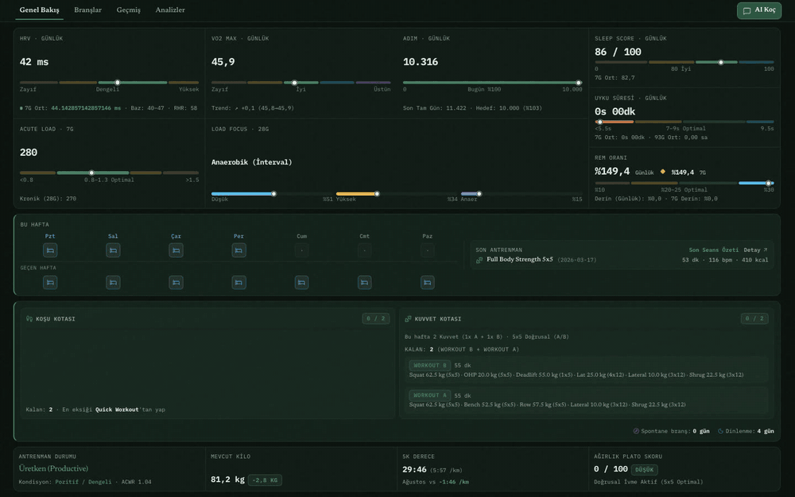
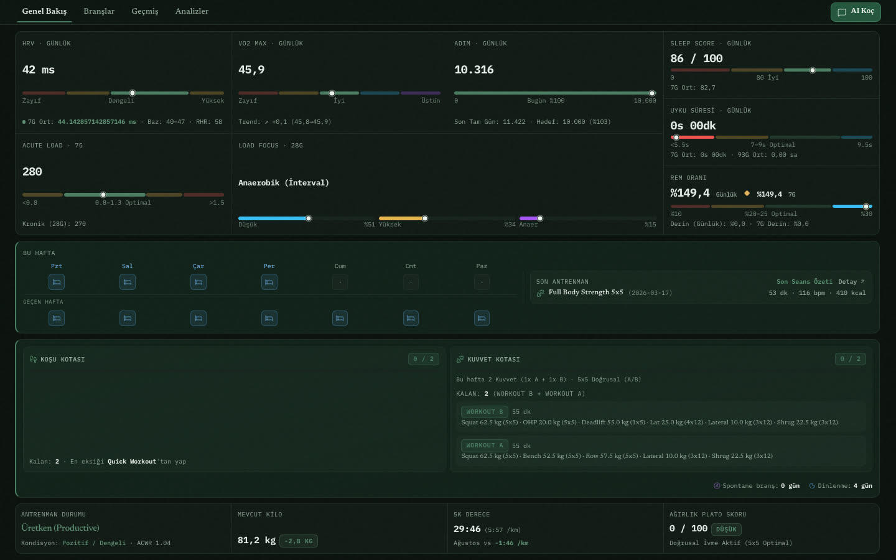
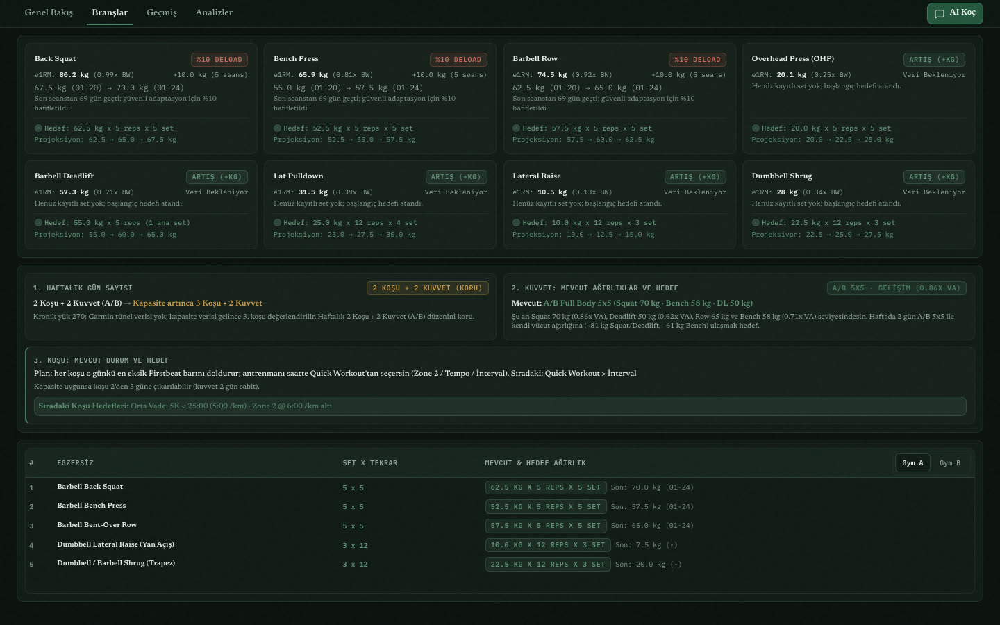
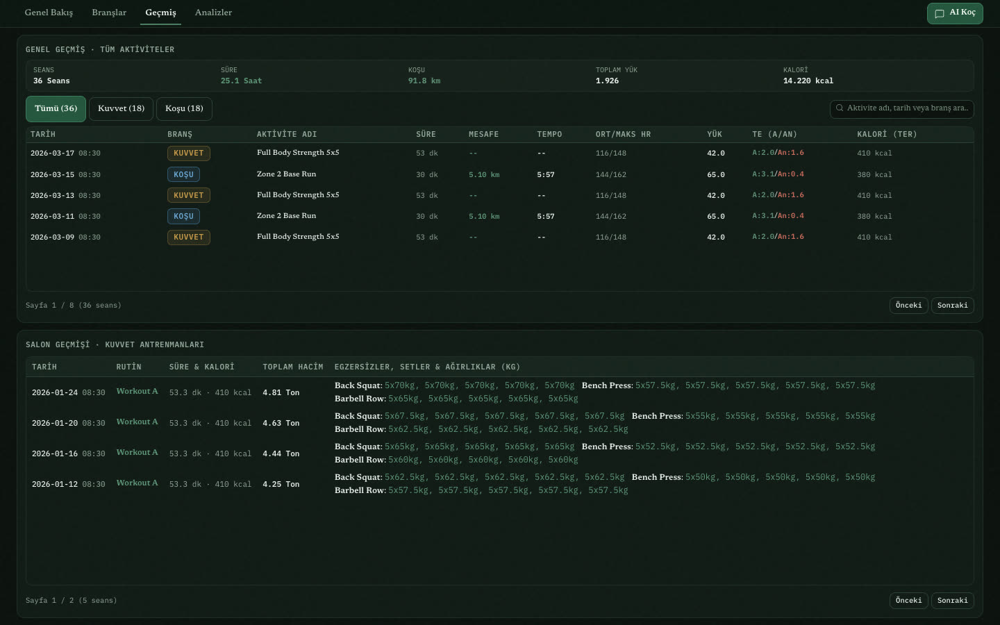
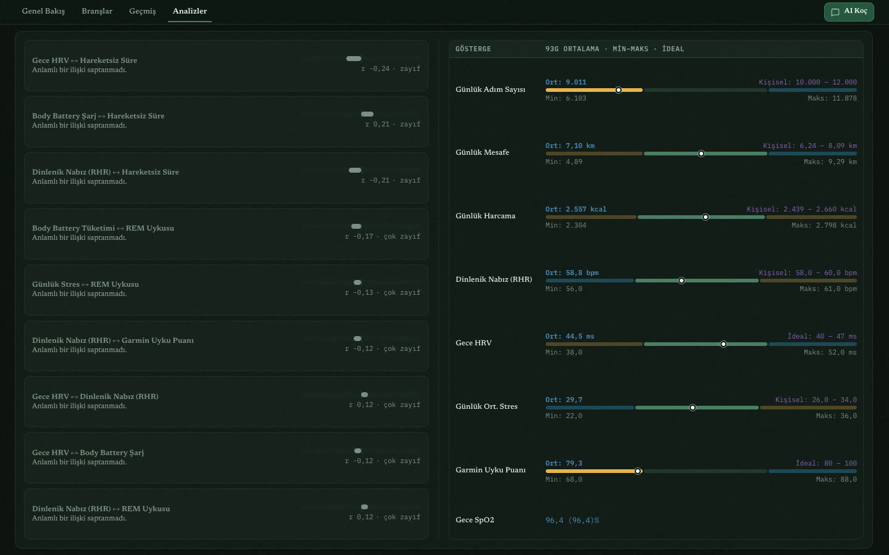
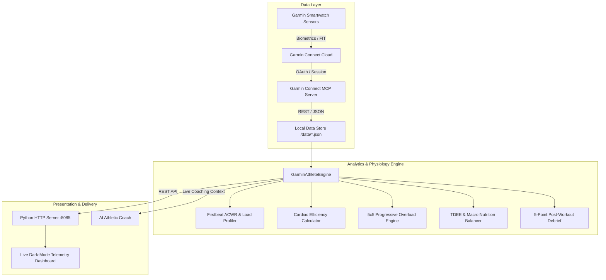

# Garmin Athlete Analytics Platform

[](https://github.com/yigitsarpavci/garmin-athlete-analytics-platform/actions/workflows/tests.yml)
[](#tests)
[](LICENSE)

A personal training-analytics app built on my own Garmin data. A Node script pulls 93 days of activities, sleep, overnight HRV, body weight, strength sets and 1 Hz `.fit` streams from Garmin Connect through an MCP server; a Python engine turns them into training-load (ACWR) guidance, a weekly plan, post-workout debriefs and an AI coach; and a local dashboard (also packaged as a native macOS app) shows it on one screen.

> **Turkish Documentation:** Detaylı Türkçe dokümantasyon için [README_TR.md](README_TR.md) dosyasına göz atabilirsiniz.

---

## Quick Start

```bash
pip install -r requirements.txt
python3 app/server.py --demo   # synthetic data, no Garmin account needed
# open http://localhost:8085
```

---

## Screenshots



| | |
|---|---|
|  |  |
| *Overview: HRV, VO2 max, ACWR load, weekly quotas* | *Per-sport breakdown* |
|  |  |
| *Workout history* | *Analytics: correlations and 93-day ranges* |

---

## What It Does

- **Training load.** Reads Garmin's acute (7-day) and chronic (28-day) load and applies Gabbett's acute:chronic workload ratio bands: 0.80–1.30 is the target range, above 1.30 the plan stops adding runs, and from 1.50 it recommends a deload.
- **Weekly plan.** Two full-body strength sessions (alternating Workout A / B, 5×5) and two to three runs, named after Garmin Quick Workouts (Interval, Tempo, Zone 2) with heart-rate bands from the athlete's own max HR. When Garmin's three load-focus bars are already full, the run target drops and a deload is suggested instead of extra volume. Lift targets come from the athlete's own set history.
- **Post-workout debrief.** Each session is compared on five points: load and ACWR, Garmin training status and VO₂ max trend, the last 24 h of biometrics (weight, resting HR, HRV, sleep, Body Battery), heart rate against the previous session of the same type, and strength tonnage and PRs.
- **High-resolution data.** A binary `.fit` decoder extracts 1 Hz heart rate, cadence, stride length, ground contact time and vertical oscillation; 5-minute overnight HRV and respiration series are exposed by the API.
- **AI coach.** Chat backed by Gemini with OpenAI (`gpt-4o-mini`) as a second provider, and deterministic rule-based answers when no key is set. The prompt carries the current load, plan and recent sessions.
- **Sync.** Incremental Garmin sync every 15 minutes (`GARMIN_SYNC_INTERVAL_SEC`), quick retries when Garmin data is incomplete, a cross-process fetch lock, a 4-minute session keep-alive, and automatic reload when data files change.
- **Demo mode.** `--demo` (or `GARMIN_DEMO_MODE=1`) runs everything on synthetic data in `sample_data/` without a Garmin account.

---

## System Architecture



---

## Formulas

| Metric | Formula | Used for |
| :--- | :--- | :--- |
| **ACWR** | acute load ÷ chronic load (Garmin's 7-day and 28-day values) | Target 0.80–1.30; above 1.30 no extra runs; ≥ 1.50 deload |
| **Efficiency factor** | speed (m/min) ÷ average heart rate | Aerobic trend between comparable runs; Zone 2 pace |
| **BMR** | Mifflin-St Jeor, 10W + 6.25H − 5A + 5 | Energy estimate (W kg, H cm, A years) |
| **TDEE** | BMR × activity factor + session energy | Daily calorie target toward `target_weight_kg` |

## 5-Point Post-Workout Debrief Protocol

Following every session, the platform benchmarks live telemetry against baseline records:

```
======================================================================
📋 5-POINT POST-WORKOUT ATHLETIC DEBRIEF (synthetic demo data)
======================================================================
[1] Training Load & ACWR   : EPOC: 14.6 | Acute: 279 | Chronic: 279 | ACWR: 1.00 (Sweet Spot)
[2] Productive Status      : Maintaining (VO2 Max: 48.0 ml/kg/min, Stabil)
[3] 24h Daily Biometrics   : Weight: 78.0 kg | RHR: 55 bpm (-5 bpm vs 4w ago) | HRV: 48 ms | Sleep: 80/100 | BB: 74
[4] Same-Sport HR Delta    : Avg: 112 bpm (-6 bpm vs last Workout A) | Max: 148 bpm (Cardiovascular Economy)
[5] Gym Tonnage & PRs      : Total Volume: 7,430 kg (+300 kg vs last Workout A)
                             Squat 70.0 kg 5x5 PR, Bench 50.0 kg 5x5 PR, Row 55.0 kg 5x5 PR
======================================================================
```

---

## Tests

```bash
make test   # or python3 tests/run_tests.py
```

101 tests (unit, API, data-integrity, security and UI-contract) cover the load and quota calculations, weekly-plan transitions (Monday reset, carrying over a deficit, off-plan runs), `.fit` and high-resolution stream parsing, the API endpoints, the security headers and host checks, and parity between the engine on real-shaped and synthetic data. Line coverage of `app/` is 76% and CI fails below 70%. CI runs on Python 3.10 and 3.12, lints with ruff, and fails if the precompiled Tailwind CSS is stale.

---

## Design Decisions & Trade-offs

- **Standard-library HTTP server.** `ThreadingHTTPServer` plus a small router keeps the runtime to Python, pandas and NumPy, which matters for a desktop app that starts its own server. The cost is hand-written routing, headers and request limits that a framework would provide.
- **Garmin's load values, not a re-implementation.** Acute/chronic load and training status come from Garmin (Firstbeat) rather than being recomputed, so the dashboard agrees with the watch; the engine adds the decisions on top (ACWR bands, plan, deload).
- **Local-only by design.** Health data never leaves the machine: the server binds to `127.0.0.1`, rejects foreign hosts and origins, and vendors its UI libraries so no CDN is contacted.
- **Rules first, LLM second.** Plans, thresholds and debriefs are deterministic and tested; the AI coach only explains them, and works without a key.
- **Mixins over one engine class.** `GarminAthleteEngine` is composed from focused mixins (load, quota, sleep, strength, debrief), which keeps files small but couples them through shared state.

## Known Limitations

- **Single athlete.** One profile and one data folder; there is no multi-user support.
- **Depends on an unofficial Garmin API.** Sync goes through a community MCP server and Garmin Connect's web session; Garmin changes can break it (demo mode keeps working).
- **Guidance, not medical advice.** The thresholds are population-level heuristics from the literature, not individual injury predictions.
- **Turkish product copy.** UI text, coaching messages and engine comments are Turkish (see below); the code identifiers and this README are English.
- **The macOS app is unsigned** (ad-hoc) and Apple Silicon only.

---

## REST API Reference

| Endpoint | Method | Description |
| :--- | :---: | :--- |
| `/api/status` | `GET` | Health check, demo/live flag, and rolling session JWT/lease metadata. |
| `/api/session/keepalive` | `GET` / `POST` | Adaptive Garmin session keep-alive heartbeat and lease renewal. |
| `/api/overview` | `GET` | Aggregated 93-day athlete overview, flexible weekly quota, weight, VO2 max, and sleep scores. |
| `/api/post-workout-debrief` | `GET` | 5-point post-workout telemetry debrief with optional `?idx=` query selector. |
| `/api/daily-protocols` | `GET` | 7-day integrated workout and nutritional prescriptions with progressive weights. |
| `/api/gym-history` | `GET` | Exercise-level resistance history, volume metrics, and personal records (PRs). |
| `/api/activities` | `GET` | All recorded Garmin activities (sport filter supported). |
| `/api/correlations` | `GET` | Pearson correlation matrix with p-values. |
| `/api/progression` | `GET` | Dynamic multi-tier progression assessment and deload recommendations. |
| `/api/sync` | `POST` | Trigger Garmin Connect sync with rolling lease reload fallback. |
| `/api/chat` | `POST` | Context-aware AI coach query execution (Gemini / OpenAI / Heuristic). |

---

## Local Setup & Quickstart

### Prerequisites
- Python 3.10+ and `pip install -r requirements.txt` (pandas, numpy)
- (Optional) Node.js 18+ for live Garmin Connect telemetry sync (`make fetch`)
- (Optional) Google GenAI or OpenAI API key for live AI coaching:
  ```bash
  export GEMINI_API_KEY="your-gemini-api-key"
  # or
  export OPENAI_API_KEY="your-openai-api-key"
  ```

### 1. Launch as macOS Desktop App (Recommended on macOS) or Web Dashboard

- **macOS Native App (`WKWebView`, macOS 13+ only):**
  ```bash
  bash macos/build_app.sh
  ```
  Installs the native macOS desktop app (`Garmin 2.0.app`) to `~/Desktop` and `~/Applications`. A prebuilt, ad-hoc-signed Apple Silicon build is attached to the [v1.0.0 release](https://github.com/yigitsarpavci/garmin-athlete-analytics-platform/releases/tag/v1.0.0): on first launch it asks for the repository folder (it runs the local Python server), and macOS may require right-click → Open because the app is not notarized. Clicking the app starts the local server automatically, keeps data synced while open, and terminates the background server cleanly when closed.
- **Web Dashboard (macOS / Linux / Windows):**
  ```bash
  make run                       # Live telemetry (or ./scripts/run_app.sh)
  python3 app/server.py --demo   # Offline synthetic demo mode (or GARMIN_DEMO_MODE=1)
  ```
  Open your browser at `http://localhost:8085`.

### 2. Run All Tests
```bash
make test         # or python3 tests/run_tests.py
```

### 3. Sync Fresh Telemetry from Garmin Connect
```bash
make fetch        # or node ./scripts/fetch_garmin_data.mjs
```

---

## Athlete Profile (nothing personal lives in the code)

Age, height, gender and goals are **never hard-coded**. They are read at runtime, in this order:

1. `data/athlete_profile.json` – optional overrides you write yourself (git-ignored). Copy [`athlete_profile.example.json`](athlete_profile.example.json) and edit it.
2. `data/raw_profile.json` – downloaded from Garmin Connect by `make fetch` (birth date → age, height, gender, lactate-threshold HR).
3. Neutral defaults. `/api/overview` then reports `athlete.profile_missing`, so the UI/CLI can tell the user which fields to fill in.

Everything else is derived from the athlete's **own Garmin data**: weight history, max/resting HR, Zone 2 and interval heart-rate bands (percentages of max HR), Zone 2 pace (efficiency factor at Z2 heart rate), interval pace (90 % of the current 5K pace), HR/power zones, lift starting loads (from body weight) and progression (from Garmin set data). Optional profile keys: `target_weight_kg`, `max_hr`, `lactate_threshold_hr`, `goal_5k_time` (e.g. `"24:30"`), `z2_goal_pace` (`"5:00"`), `z2_goal_date` (`"2027-04-15"`). Macro periods, the activity window, the Zone 2 goal timeline and guest-plan heart-rate bands are all derived from your own date range, Garmin data or profile; there are no hard-coded dates.

## Security & Privacy

The dashboard serves personal health data, so the server is locked down to the local machine:

- Binds to `127.0.0.1` only. Requests whose `Host` header is not `localhost` / `127.0.0.1` / `::1` are rejected (DNS-rebinding defence).
- **No CORS.** The UI is same-origin; requests carrying a foreign `Origin`, or `Sec-Fetch-Site: cross-site`, get `403`. A random website open in your browser cannot read your data or trigger `/api/sync`.
- `GET` endpoints have no side effects (only `POST /api/sync` and `POST /api/session/keepalive` contact Garmin). POST bodies are capped at 1 MB.
- Strict `Content-Security-Policy` (`script-src 'self'`, no inline scripts or inline event handlers: the UI uses `data-calls` attributes and one delegated listener), `X-Frame-Options: DENY`, `nosniff`.
- The UI is fully **offline-capable**: Lucide and the fonts are vendored with pinned versions and SHA-256 hashes in [`app/static/vendor/VENDOR.md`](app/static/vendor/VENDOR.md). No CDN is contacted at runtime.
- Personal telemetry lives in `data/` (git-ignored). Demo mode (`GARMIN_DEMO_MODE=1`) never touches your Garmin account or `data/`.

## Language & Conventions

- **Code identifiers, API keys and file names are English.** Product copy that the athlete reads (UI text, coaching messages, docstrings and comments in the engine) is **Turkish** by design: the app is a personal coaching tool for a Turkish-speaking athlete. The English README exists for developers; [README_TR.md](README_TR.md) mirrors it.
- Engine modules are mixins composed by `GarminAthleteEngine`; computation stays in the backend and the UI only renders.
- Any change must keep `python -B tests/run_tests.py` green. CI (`.github/workflows/tests.yml`) runs the suite on Python 3.10 and 3.12 against synthetic `sample_data/`.
- Install dependencies with `pip install -r requirements.txt`.

### 4. Developer tooling
```bash
make css      # rebuild app/static/css/tailwind.css (Tailwind 3.4.17 CLI via npx; no runtime compiler in the browser)
make lint     # ruff (pyflakes rules) over app/, tests/, scripts/
make test     # 101 tests
```
CI also fails when `css/tailwind.css` is stale. The Garmin sync is **incremental** (finalised days are cached; `node scripts/fetch_garmin_data.mjs --full` forces a complete refresh).

## Project Structure

```
garmin-athlete-analytics-platform/
├── app/                              # Web server, analytics engine & UI
│   ├── server.py                     # REST API and static asset server
│   ├── garmin_engine.py              # Sports science & ACWR orchestrator
│   ├── ai_coach.py                   # Multi-provider LLM coaching service
│   ├── engine/                       # Modular telemetry, quota & morphology mixins
│   └── static/                       # Dark-mode modular web dashboard (vendor/: pinned offline libs & fonts)
├── sample_data/                      # Synthetic demo telemetry for quickstarts
├── data/                             # Local Garmin telemetry JSONs (gitignored)
│   └── archive/                      # Archived single-activity raw JSONs
├── scripts/                          # Live sync & launch scripts
│   ├── run_app.sh                    # Web application launcher
│   └── fetch_garmin_data.mjs         # Garmin Connect MCP ingestion script
├── tests/                            # Automated unit & API test suite
│   ├── run_tests.py
│   ├── test_engine_calculations.py
│   ├── test_api_endpoints.py
│   ├── test_data_integrity.py
├── .github/workflows/tests.yml       # CI: tests (Python 3.10 / 3.12) + JS syntax check
├── requirements.txt                  # pandas, numpy (+ optional AI / FIT extras)
├── Makefile                          # Unified run, test, and fetch shortcuts
├── README.md                         # English documentation
├── README_TR.md                      # Turkish documentation
└── LICENSE                           # MIT License
```

---

## Stack

Python 3.10+ (standard-library HTTP server, pandas, NumPy) · Node.js MCP client for Garmin Connect · vanilla ES modules with hand-built SVG/CSS charts, precompiled Tailwind · Swift / WKWebView macOS wrapper · unittest, ruff, GitHub Actions, CodeQL, Dependabot.

## License

[MIT](LICENSE) · Yiğit Sarp Avcı · [GitHub](https://github.com/yigitsarpavci) · [LinkedIn](https://www.linkedin.com/in/yigitsarpavci)
